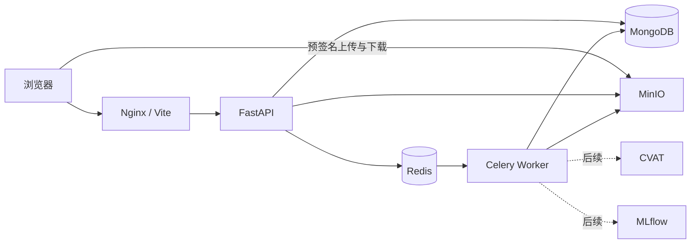

# 系统设计

## 目标与边界

系统统一归档图片、视频、标注、模型和压缩文件，提供检索、预览、关系管理、模型溯源、回收站与导出。首版不执行训练、推理、自动标注或模型效果评估。FiftyOne 只作为交互参考。

## 组件架构

API 保存业务元数据并签发 MinIO 地址。浏览器直接传输大文件。校验、媒体处理、数据集包导入、导出和物理清理由 Worker 执行。

## 核心集合

| 集合 | 关键字段 | 说明 |
| --- | --- | --- |
| `assets` | type, name, remark, object_key, sha256, size, mime_type, media, tags, metric_values, status, archived_at | 文件元数据、模型参数值与处理状态 |
| `relations` | source_id, target_id, relation_type, status, provenance, revoke_reason | 有方向的资产关系 |
| `datasets`、`dataset_memberships` | name, status, projects, asset_id, updated_at | 当前数据集、所属项目及成员 |
| `metric_categories`、`metric_definitions` | id, name, category, description, built_in | 指标分类与定义，值独立保存在模型素材上 |
| `dataset_versions`、`dataset_version_memberships` | version, member_count, content_digest, snapshot | 发布后固定版本与成员摘要；确认删除关联素材时同步修正 |
| `collections` | name, kind, asset_ids, revision, frozen_at | 旧集合兼容与迁移来源 |
| `saved_views` | owner_id, name, query, sort, fields, shared | 保存筛选规则 |
| `jobs` | type, state, progress, input, result, error, heartbeat_at, expires_at | 后台任务、取消状态和运行心跳 |
| `tag_definitions` | key, name, values, color, free_input, built_in | 标签字段配置及默认标签保护 |
| `format_definitions` | asset_type, extensions, protected_extensions, built_in, remark | 格式识别配置 |
| `users` | username, password_hash, status, roles, menu_permissions, action_permissions | 用户、角色、菜单权限与操作权限 |
| `audit_logs` | actor_username, action, object_type, object_id, object_name, changes, request_id, created_at | 系统关键操作审计日志 |

## 素材与格式

持久素材类型包括 `image`、`video`、`annotation`、`model`、`archive` 和 `other`。`image_annotation` 是上传时手动选择的处理方式：Worker 成功导入后删除原压缩对象和临时资产，只保留解压得到的图片、标注及关系，因此素材库不展示“图片+标注”类型。

内置格式类别和扩展名不可修改、删除。默认标签可以修改但不允许删除；用户新增标签可以维护和删除，但已有素材正在使用时必须先迁移或移除对应标签。

## 标注导入与预览

“图片+标注”支持以下 CVAT 常用导出格式：

- YOLO Detection：同名图片与 TXT，类别来自 `data.yaml`、`obj.names` 等；
- Pascal VOC：图片和同名 XML；
- CVAT for images：统一 `annotations.xml`，按 `<image name>` 关联；
- COCO：JSON 中按 `images[].file_name` 关联。

同一压缩包出现多种有效标注格式时终止导入。当前绘制矩形框和多边形；Mask、关键点、骨架、旋转框、轨迹和视频逐帧标注暂不绘制。没有有效标注关系的图片显示“尚未建立图片与标注的对应关系”。

## 标签与筛选

标签定义保留名称、枚举值、颜色及历史自由输入配置。同一素材的同一标签可以保存多个值；当前素材批量添加标签只能选取标签管理中的最新枚举值，不提供自定义输入。素材备注是独立字段。

素材库支持名称和备注模糊搜索、素材类型、无标签以及标签、备注、创建时间、修改时间组合筛选。修改备注或标签会更新 `updated_at`。

## 关系

当前允许写入的关系类型只有 `annotates` 和 `trained_on`。`contains` 仅用于图谱中只读推导的数据集版本成员边；`produced_by`、`version_of` 只保留为历史数据的兼容展示，不再允许新建。关系源与目标不能相同；前端选择器禁用自身，后端进行最终校验。

自动关联优先读取标注内容中的图片引用，没有引用时使用不区分大小写的文件基础名称。同名图片或同一图片被多个标注声明时列为冲突。提交前先预览，确认后批量创建。

图片与标注使用 `annotates` 关系。图片进入当前数据集时带入有效标注；撤销图片与标注关系后，只调整未发布的当前数据集，历史版本保持不变。模型只通过 `trained_on` 关系关联已发布的数据集版本，不再直接关联图片、视频、标注或压缩文件。图谱中的版本成员路径为只读推导结果，不额外写入模型直连关系。关系软撤销后从有效图谱移除，但保留历史和审计。

早期版本使用过 `asset_versions` 集合，当前版本由 `dataset_versions` 和 `dataset_version_memberships` 承担发布后的版本快照；明确确认删除关联素材是允许修正这些快照的例外，Worker 清理逻辑仍兼容删除遗留记录，但不再写入新数据。

## 删除与导出

删除素材先进入回收站。还原会清除删除状态；清空回收站由后台任务物理删除 MinIO 对象和相关记录。

导出 ZIP 只包含所选原文件，同名文件自动增加标识避免覆盖。任务中心展示素材导出、数据集导出和清空回收站任务，不展示内部素材处理任务；支持筛选、失败重试和导出取消。Worker 定期写入运行心跳，API 启动时恢复长时间无更新的异常任务。

## 安全与权限

访问令牌短期有效且仅保存在前端运行内存中；可撤销的刷新令牌保存在 `HttpOnly`、`SameSite=Strict` Cookie 中，不暴露给前端脚本。密码使用 Argon2 哈希。

系统提供管理员、数据管理员、标注员、算法工程师、只读访客和自定义六类角色。固定角色使用系统预设权限；自定义角色分别保存菜单权限与操作权限，也可以从固定角色模板复制后继续调整。菜单权限决定页面和只读接口是否可访问，操作权限决定上传、编辑、删除、保存视图、关系维护、导出、回收站、标签、格式和用户管理等动作是否可执行。数据集权限进一步拆分为创建编辑、成员管理、版本发布、版本恢复、删除和模型关联。前端仅负责隐藏无权限入口，后端依赖校验是最终权限边界。操作权限必须依附于对应菜单，移除菜单时同步移除该菜单下的操作权限。

登录或恢复会话后，前端通过当前用户权限接口同步有效权限，只加载当前有权访问页面所需的数据，不预取无权限菜单的数据。用户资料或权限变更会撤销其刷新会话；已有访问令牌发起请求时仍会读取数据库中的最新权限。所有关键写操作记录请求 ID 和审计事件。

系统日志使用独立菜单权限。管理员默认可以访问，自定义角色可以只获得系统日志读取权限而不获得用户管理权限。日志页面支持关键字、操作、对象类型、创建时间和分页筛选，列表展示目标类型和名称，右侧详情使用中文字段展示完整变更内容。

开发环境首次启动创建 `admin/admin`。正式部署必须通过环境变量替换管理员密码、JWT 密钥和 MinIO 凭据；生产模式会拒绝默认、空值或过短的凭据。

## 已知限制

项目概览由服务端按项目聚合，结合来源页面权限过滤数据；当前成员与历史版本分开统计。模型参数是文件级元数据，关联关系只维护关联备注，详见[数据集与项目概览](datasets.md)和[模型参数](model-parameters.md)。模型参数保存同时更新 `modified_at` 与 `updated_at`。

- 单机部署，不包含高可用、多租户和 Kubernetes；
- CVAT 和 MLflow 在线集成尚未实现；
- Linux Docker 全新部署和生产备份恢复尚未完成实机演练；

前端的弹窗键盘行为和关系分页使用独立工具模块；后端的数据集版本流式对比位于 `dataset_versioning.py`，路由仅负责权限、参数和响应编排。新增大数据量逻辑应继续放入独立服务模块，避免继续扩大页面和路由文件。
- 超大列表仍采用分页和分批加载，前端尚未使用虚拟滚动。
